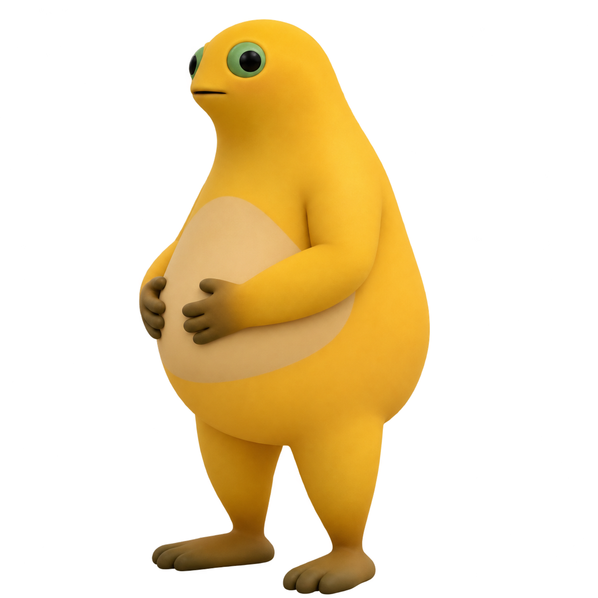
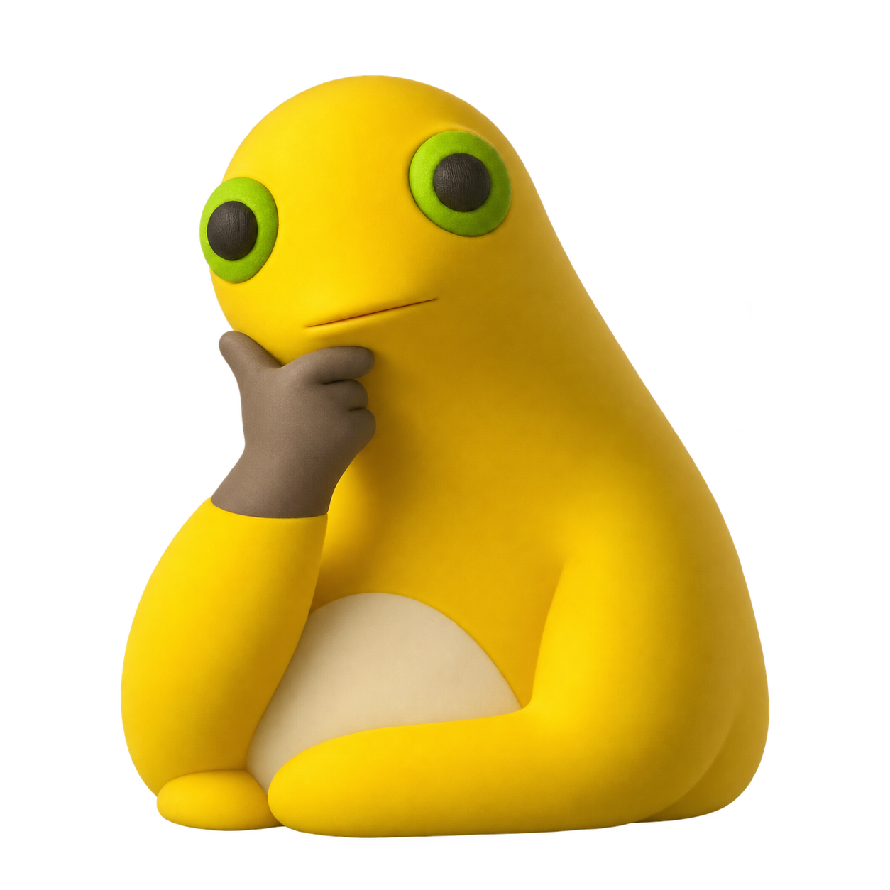
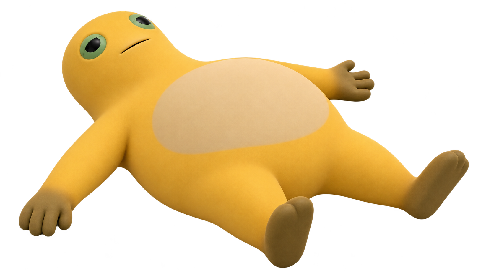

# 奶蛙桌宠 · NaiWaDesktopPet

一款基于 **C# / WinForms** 的 Windows 桌面宠物，支持高清动画、自然眨眼与呼吸、鼠标互动、展翼飞行和可切换音效。

## 角色预览

内置静态姿势预览，实际运行包含动画与动作过渡。

| 待机奶蛙 | 沉思奶蛙 | 躺平奶蛙 |
| :---: | :---: | :---: |
|  |  |  |

## 主要功能

- **日常陪伴**：自然呼吸、眨眼，支持大笑、跳跃、躺平和沉思。
- **鼠标互动**：肚子 Q 弹回弹、点击腿脚后退、双击大笑、长按飞行。
- **展翼飞行**：展开翅膀飞向屏幕边缘，落稳后收翼；朝向随方向变化，中断后可继续。
- **动作音效**：各动作可独立设置音效，大笑动作随音频进度连续播放。
- **桌面操作**：拖动定位、跨显示器拖动、暂停动画、始终置顶和桌面快捷方式。

绘制目标为 **100 FPS**，实际刷新效果取决于电脑性能和显示器。

## 快速开始

运行环境：**Windows + .NET Framework**，当前在 Windows 10 / .NET Framework 4.8 下验证。

1. 完整解压项目，保持程序与 `assets` 文件夹位于同一目录。
2. 双击 **`启动奶蛙.bat`**，或直接运行 **`NaiwaDesktopPet.exe`**。
3. 左键拖动奶蛙调整位置，右键打开动作与设置菜单。

双击 `创建桌面快捷方式.vbs` 可添加桌面快捷方式；移动文件夹后重新运行即可更新。

## 鼠标操作

| 操作 | 效果 |
| --- | --- |
| 按住左键拖动 | 移动奶蛙 |
| 单击肚子 | 按压并 Q 弹回弹 |
| 单击腿脚 | 后退，显示“你干嘛，矮油~” |
| 双击奶蛙 | 捧腹大笑 |
| 长按约 0.85 秒且不拖动 | 展翼飞向屏幕边缘 |
| 单击右键 | 打开动作、音效、暂停、置顶和退出菜单 |

## 音效设置

右键悬停 **“音效设置”**，拖动滑块或点击选项切换。大笑、跳跃和沉思支持 **关 / 开**，躺平支持 **关 / 男声 / 女声**，每次启动默认全部关闭。

切换动作会停止上一段音效；暂停、拖动和打开菜单时，音效与动画一起暂停。

## 开发与更多说明

在项目根目录打开 Windows PowerShell，执行以下命令构建程序：

```powershell
powershell.exe -NoProfile -ExecutionPolicy Bypass -File .\Build-Naiwa.ps1
```

构建使用 Windows PowerShell 5.1 和 .NET Framework C# 编译器。

- [详细使用、分享与开发检查](使用说明.md)
- [角色与图标来源](assets/naiwa/SOURCES.md) · [音效来源](assets/audio/SOURCES.md)
- [问题反馈与建议](https://github.com/LiuSailing/NaiWaDesktopPet/issues)

本项目原创代码与脚本采用 [MIT 许可证](LICENSE)，允许修改、分发及商用，须保留版权与许可声明。

图片、图标、音效及其他第三方素材按各自来源与许可处理，不包含在上述代码授权中。部分素材的再分发授权仍待核实，具体状态见 [角色与图标来源](assets/naiwa/SOURCES.md) 和 [音效来源](assets/audio/SOURCES.md)。
